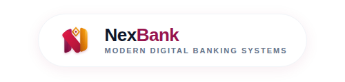
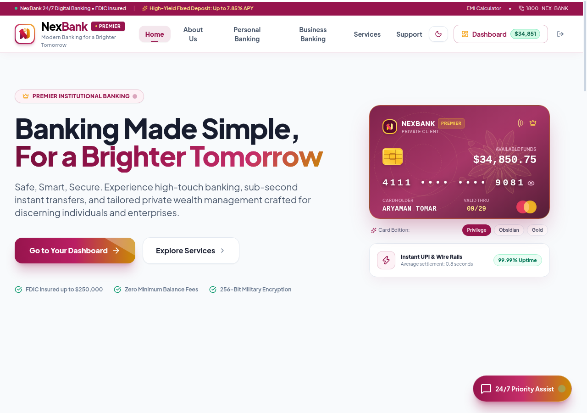
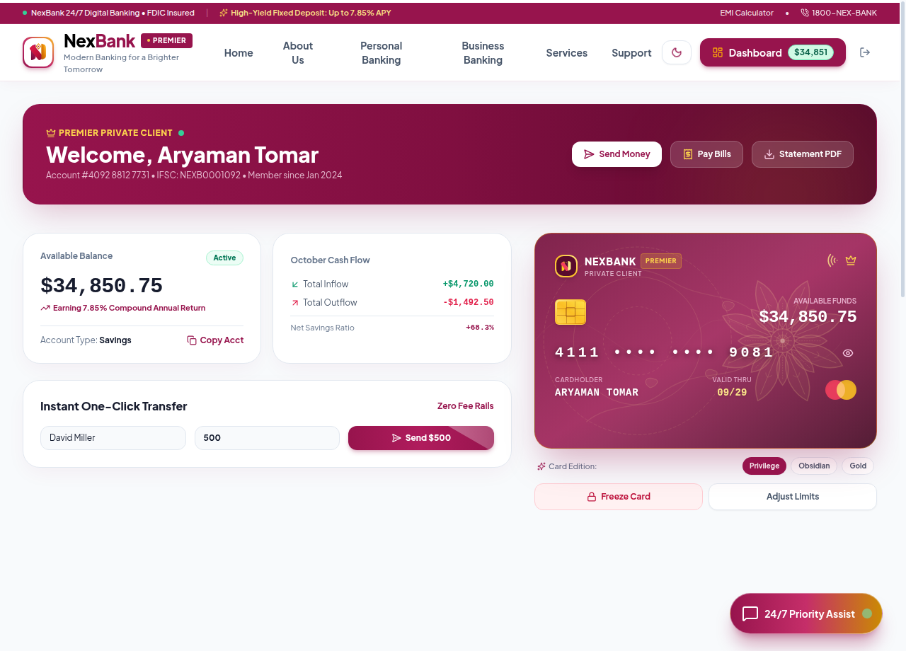
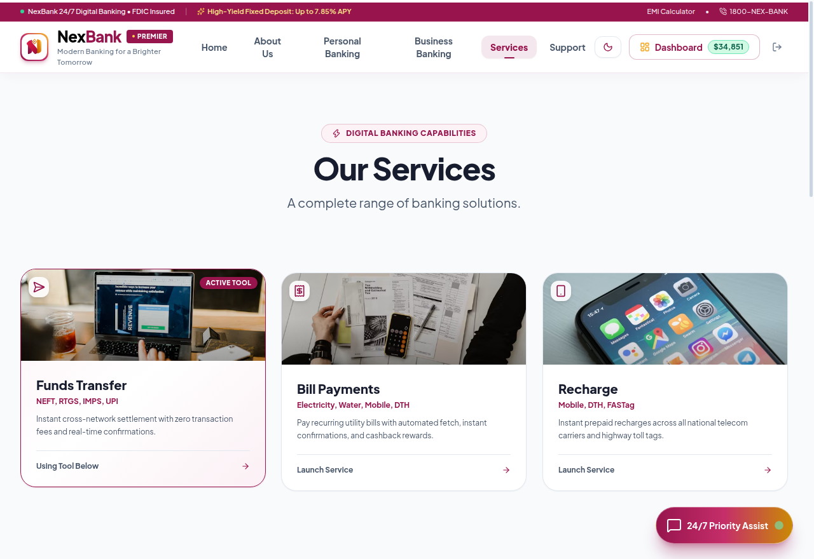
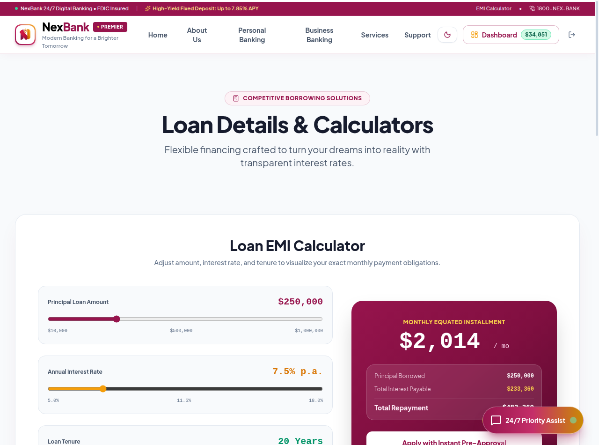
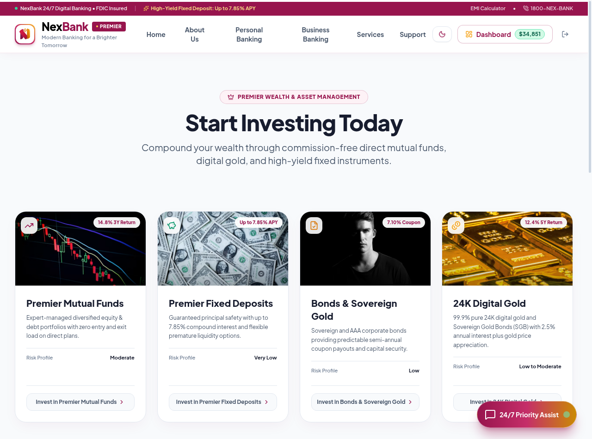
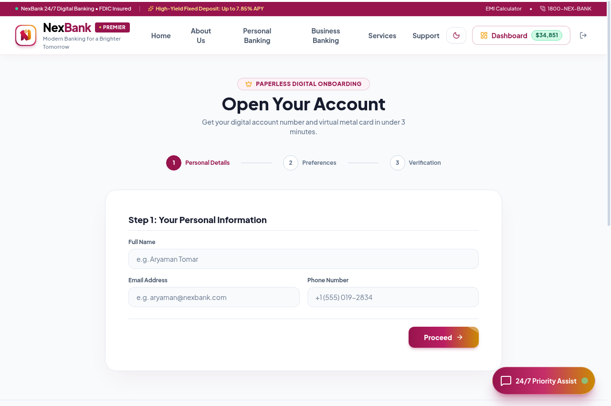
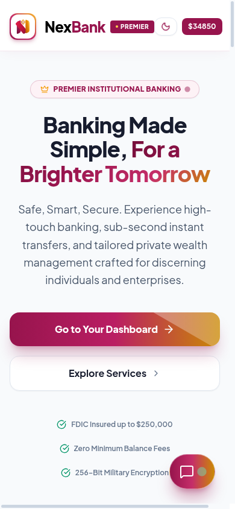
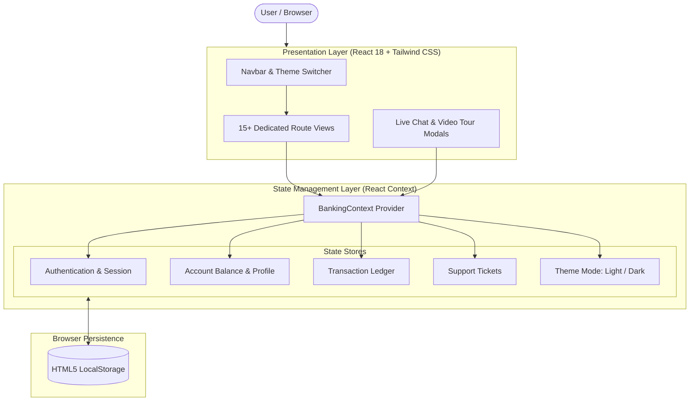

<div align="center">

  

  # NexBank — Modern Digital Banking Platform

  <p align="center">
    <strong>A next-generation, responsive digital banking web application engineered with React 18, TypeScript, Vite, and Tailwind CSS.</strong>
  </p>

  <p align="center">
    <a href="#-key-features">Key Features</a> •
    <a href="#-live-ui-showcase">UI Showcase</a> •
    <a href="#-sitemap--route-architecture">Sitemap</a> •
    <a href="#-tech-stack">Tech Stack</a> •
    <a href="#-getting-started">Getting Started</a> •
    <a href="#-project-structure">Project Structure</a>
  </p>

  <p align="center">
    
    
    
    
    
  </p>

</div>

---

## 📖 Overview

**NexBank** is an enterprise-grade digital banking web platform built from the ground up to showcase modern financial technology interfaces, real-time client-side banking simulation, and accessible responsive design. 

Built with **React 18**, **TypeScript**, and **Tailwind CSS**, NexBank features 15+ dedicated routes, interactive fund transfer simulators (IMPS, NEFT, RTGS, UPI), dynamic financial intelligence calculators (Loan EMI & SIP Wealth), a 3-step paperless KYC onboarding wizard, a logged-in user dashboard with interactive metal card controls, customer support ticket tracking, and seamless Dark/Light mode theme switching.

---

## 📸 Live UI Showcase

<div align="center">
  <h3>Desktop Banking Portal</h3>
  
</div>

<br />

<div align="center">
  <table>
    <tr>
      <td width="50%">
        <h4 align="center">💳 Online Banking Dashboard</h4>
        
      </td>
      <td width="50%">
        <h4 align="center">💸 Live Fund Transfer Simulator</h4>
        
      </td>
    </tr>
    <tr>
      <td width="50%">
        <h4 align="center">📈 Dynamic Loan EMI Calculator</h4>
        
      </td>
      <td width="50%">
        <h4 align="center">🌱 SIP Wealth Accumulator</h4>
        
      </td>
    </tr>
    <tr>
      <td width="50%">
        <h4 align="center">📝 3-Step Account Onboarding</h4>
        
      </td>
      <td width="50%">
        <h4 align="center">📱 Mobile Responsive Architecture</h4>
        
      </td>
    </tr>
  </table>
</div>

---

## ✨ Key Features

### 1. 🏦 Digital Onboarding & KYC Wizard (`/open-account`)
- Frictionless 3-step onboarding workflow (Personal Details, Identity Verification & Document Upload, Account Customization).
- Real-time automated generation of **Account Number**, **IFSC code**, **Customer ID**, and a customized **Virtual Metal Card**.
- Direct balance initialization and automated transition into the dashboard.

### 2. 💳 Smart Online Banking Dashboard (`/dashboard`)
- Instant balance overview, monthly cash inflow/outflow metrics, and quick action shortcuts.
- **Interactive Virtual Metal Card**:
  - Live 16-digit card visualization with dual-side flip effect.
  - Interactive **CVV / Card Number reveal** toggle with security mask.
  - One-click **Freeze / Unfreeze Card** status toggle.
- Real-time transaction history with categorization badges and timestamps.

### 3. ⚡ Core Financial Services Simulators (`/services`)
- **Live Transfer Engine**:
  - Multi-rail support: **IMPS** (Instant), **NEFT** (National Electronic), **RTGS** (High Value), and **UPI ID** transfer.
  - Dynamic beneficiary validation, fee computation, and real-time ledger deduction.
- **Utility Bill Payments & Recharges**:
  - Interactive simulator for Electricity, Water, Broadband, and Mobile prepaid/postpaid recharges.
- **Locker & Wealth Services**:
  - Digital locker applications and physical vault booking previews.

### 4. 🧮 Financial Intelligence & Calculators
- **Loan EMI Calculator (`/loans`)**:
  - Real-time dynamic sliders for Principal Amount, Interest Rate, and Tenure.
  - Instant monthly EMI, total interest payable, and overall loan breakdown computation.
- **SIP Wealth Growth Engine (`/investments`)**:
  - Compound interest calculation engine modeling monthly SIP contributions over 1 to 30 years.
  - Visual metrics contrasting invested capital versus estimated wealth returns.

### 5. 🛡️ Business & Enterprise Suite (`/business`)
- Dedicated portals for Commercial Banking, Business Loans, Trade Finance, and Merchant POS services.
- Embedded **Developer REST API preview** with interactive payload and JSON response inspection.

### 6. 🎫 Customer Support Hub & Ticketing (`/support`, `/faq`)
- Instant complaint lodging system that assigns a unique tracking ticket (`TKT-XXXXXX`).
- Real-time **Ticket Status Tracker** with simulated resolution workflow.
- Searchable accordion-style FAQ knowledge base across banking, cards, and security.
- Interactive **24/7 Live Chat Assistant** modal with automated contextual responses.

### 7. 🌓 Modern UX & Theming
- High-contrast, WCAG AA compliant **Light Mode** and **Dark Mode** toggle.
- Custom glassmorphic styling, smooth micro-interactions, and responsive layout across mobile, tablet, and desktop viewports.
- Integrated **Faceless Video Tour Modal** allowing users to watch an architectural overview video directly within the app.

---

## 🧭 Sitemap & Route Architecture

All 15 routes specified in the system design are fully functional:

| Route | Page | Description |
|---|---|---|
| `/` | **Home** | Hero banner with CTA, mobile app preview, trust badges, and feature highlights |
| `/about` | **About Us** | Company vision, corporate values, milestones timeline, and executive leadership |
| `/personal` | **Personal Banking** | Savings Accounts (5.25% APY), Current Accounts, Fixed Deposits, and Card tiers |
| `/business` | **Business Banking** | Commercial accounts, trade finance, merchant services, and developer API preview |
| `/services` | **Our Services** | Interactive transfer simulator (IMPS/NEFT/RTGS/UPI), bill payments, and recharges |
| `/loans` | **Loan Details** | Home, Auto, Personal, and Education loans with dynamic interactive EMI calculator |
| `/investments` | **Wealth & Investments** | Mutual funds, fixed deposits, gold bonds, and dynamic SIP wealth calculator |
| `/open-account` | **Digital Onboarding** | 3-step KYC onboarding wizard issuing live virtual accounts and cards |
| `/dashboard` | **Banking Portal** | Logged-in customer dashboard with real-time balance, card freeze/CVV controls, and ledger |
| `/support` | **Customer Support** | Support ticketing engine, real-time ticket tracker, toll-free lines, and live chat |
| `/contact` | **Contact & Branches** | Global branch selector, ATM locator, direct inquiry form dispatch |
| `/faq` | **FAQ Knowledge Base** | Categorized accordion answering common banking and digital security inquiries |
| `/login` / `/signup` | **Authentication** | Demo credentials, 1-Click Demo Login, credential validation, and security badges |
| `/terms` | **Terms & Conditions** | Regulatory compliance, electronic fund transfer agreements, and disclosures |
| `/privacy` | **Privacy Policy** | AES-256 cryptographic standards, GLBA, and GDPR data protection practices |
| `/404` | **Not Found** | Clean custom fallback page with one-click navigation back to safety |

---

## 🛠️ System Architecture



---

## ⚡ Tech Stack

| Domain | Technology | Purpose |
|---|---|---|
| **Framework** | [React 18](https://react.dev/) | Component-based UI architecture |
| **Language** | [TypeScript 5.7](https://www.typescriptlang.org/) | Type-safe static analysis and robust contracts |
| **Build Tool** | [Vite 6](https://vitejs.dev/) | Lightning-fast HMR and optimized asset bundling |
| **Styling** | [Tailwind CSS 3.4](https://tailwindcss.com/) | Utility-first responsive styling and theme tokens |
| **Icons** | [Lucide React](https://lucide.dev/) | Consistent, lightweight SVG iconography |
| **State Management** | React Context API | Centralized banking state with zero external runtime overhead |
| **Storage** | HTML5 LocalStorage | Client-side session and transaction persistence |
| **Media & Showcase** | WebVTT / HTML5 Video | Native product video tour and caption delivery |

---

## 🚀 Getting Started

### Prerequisites

Ensure you have the following installed on your machine:
- **Node.js**: `v18.0.0` or higher ([Download Node.js](https://nodejs.org/))
- **npm**: `v9.0.0` or higher (bundled with Node.js) or **pnpm** / **yarn**

### 1. Clone the Repository

```bash
git clone https://github.com/aryamantomar/BankingSystem.git
cd BankingSystem
```

### 2. Install Dependencies

```bash
npm install
```

### 3. Start Development Server

```bash
npm run dev
```

Open your browser and navigate to `http://localhost:5173` to explore the application.

### 4. Build for Production

```bash
# Type check and build optimized bundle
npm run build

# Preview production build locally
npm run preview
```

---

## 🔑 Demo Access & Testing

NexBank includes built-in mock accounts and a **1-Click Demo Login** button on the `/login` screen so you can immediately explore the logged-in dashboard and card features:

- **Customer ID / Email**: `alex.morgan@nexbank.com`
- **Password**: `NexBank@2026`
- **Or simply click**: `⚡ Fill Demo Credentials` on the Login page.

> [!TIP]
> You can also create a brand new account using the **[Open Account](/open-account)** wizard to experience the automated onboarding, virtual debit card allocation, and instant balance initialization.

---

## 📁 Project Structure

```
nexbank/
├── public/                      # Static assets & web-optimized video
│   ├── nexbank-logo.svg         # Vector brand logo
│   └── nexbank_showcase.mp4     # Production video tour
├── report_images/               # High-resolution architectural screenshots
├── src/
│   ├── components/              # Modular UI components
│   │   ├── BankCardArt.tsx      # Virtual 3D metal card with flip & freeze
│   │   ├── Footer.tsx           # Multi-column footer with regulatory links
│   │   ├── LiveChatModal.tsx    # 24/7 interactive chat assistant
│   │   ├── Navbar.tsx           # Responsive navbar with quick routes
│   │   ├── NexBankLogo.tsx      # Configurable SVG logo component
│   │   ├── ThemeToggle.tsx      # Dark/Light mode theme switch
│   │   ├── Toast.tsx            # Floating feedback notifications
│   │   └── VideoTourModal.tsx   # Built-in walkthrough video modal
│   ├── context/
│   │   └── BankingContext.tsx   # Centralized banking state engine
│   ├── data/
│   │   └── bankingData.ts       # Mock data & initial ledger records
│   ├── pages/                   # 15+ Route page components
│   │   ├── HomePage.tsx
│   │   ├── DashboardPage.tsx
│   │   ├── ServicesPage.tsx
│   │   ├── LoansPage.tsx
│   │   ├── InvestmentsPage.tsx
│   │   ├── AccountOpeningPage.tsx
│   │   ├── SupportPage.tsx
│   │   └── ...
│   ├── types.ts                 # Core TypeScript interface definitions
│   ├── App.tsx                  # Client-side router and root layout
│   ├── index.css                # Tailwind custom glassmorphic utilities
│   └── main.tsx                 # React DOM mount point
├── video_showcase/              # Master video assets, audio pipelines, & scripts
├── package.json                 # Project dependencies and npm scripts
├── tailwind.config.js           # Design tokens, colors, and keyframe animations
├── tsconfig.json                # TypeScript compiler configuration
└── vite.config.ts               # Vite configuration
```

---

## 🎬 Video Showcase Assets

The project includes a complete Full HD (1920x1080) walkthrough video generated with custom Microsoft Neural Voiceover, synchronized subtitles (`.vtt` / `.srt`), and ambient background music.
To learn more about the production pipeline or inspect the generation scripts, refer to the [video_showcase/README.md](file:///home/aryaman-tomar/Desktop/nexbank/video_showcase/README.md).

---

## 🤝 Contributing

Contributions, issues, and feature requests are welcome!
Feel free to check the [issues page](https://github.com/aryamantomar/BankingSystem/issues).

1. Fork the Project
2. Create your Feature Branch (`git checkout -b feature/AmazingFeature`)
3. Commit your Changes (`git commit -m 'feat: Add some AmazingFeature'`)
4. Push to the Branch (`git push origin feature/AmazingFeature`)
5. Open a Pull Request

---

## 📄 License

This project is licensed under the **MIT License** — see the [LICENSE](LICENSE) file for details.

---

<div align="center">
  <sub>Engineered with care by <a href="https://github.com/aryamantomar">Aryaman Tomar</a>.</sub>
</div>
